# Sonar

> **Sonar requires [Npcap](https://npcap.com/) to work.** It is the free Windows driver that lets a program read network traffic, and no packet sniffer on Windows works without it. Its licence forbids anyone bundling it, so it is a separate install — the Sonar installer checks for it and points you at it, but you can get it out of the way [first](#install).

**A damage tracker for Realm of the Mad God that tells you what actually happened in the run.**

Who did the damage. To which boss. With what gear. How much of it was you.

[**⬇ Download the latest release**](https://github.com/JustAutomate-AI/sonar-rotmg/releases/latest) — get `Sonar-<version>-setup.msi`, not the green "Code" button. It installs for your user only, so Windows never asks for administrator rights.

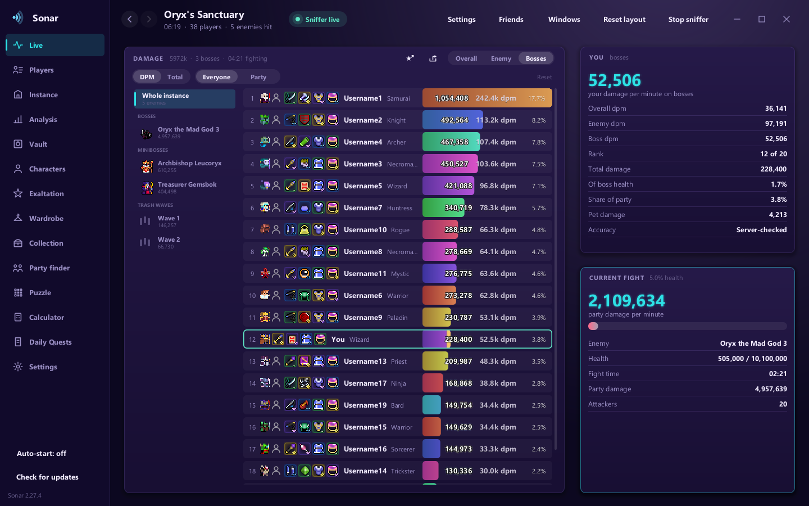

Sonar reads the game's network traffic on your own machine and never writes to it. No injection, no automation, nothing sent to the game.

---

## Damage, counted properly

Most meters give you one number for the whole run. Sonar splits the run the way it actually happened: **the bosses, the lesser bosses, and the trash in between, each on its own.** A player who padded their total on minions drops down the list the moment you look at the boss; a player who showed up for the fight that mattered climbs it.

- **Three scopes** — the whole instance over elapsed time, one enemy at a time, or bosses only
- **Two measures** — damage per minute, or total damage dealt. Per minute because a minute is the span people actually compare over, and a per-second figure jumps around with every shot; the player page keeps per second, where one person is being read closely
- **Two audiences** — everyone in the instance, or just your party
- **Your own damage is server-checked.** The game never reports your own hits, so Sonar holds its calculation against the health each enemy was actually seen to lose
- **Pet damage is counted separately**, so it never inflates your number
- **Damage into a boss's guard is counted separately**, and shown as **red on the right end of that player's bar**. In Oryx's Sanctuary, damage put into the guard fills it rather than hurting him, and filling it pushes the fight into its next phase early — so somebody who did nothing but shoot the guard has a bar that is red nearly all the way along. Read from the boss's own state at the moment of each hit
- **A two-click reset** zeroes the current instance, with undo

## Every player, down to the item

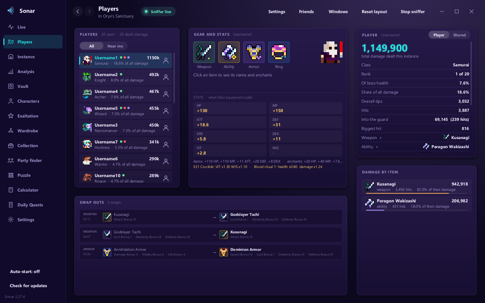

Click anyone's bar and the page fills in: their class and skin, every piece of gear with its enchants, their stats with equipment and exalt bonuses broken out, their hit count and biggest hit — and **where their damage came from**, split by weapon and ability.

### What they changed, and when

Below the roster, **Swap outs** lists every piece of gear that player changed during the run, with the time it happened — a melee weapon brought out for a chest phase, an armour change before a hit everyone knows is coming. Every hit already carries the four slots and their enchants at the moment it landed, so none of it has to be guessed at. A board that shows only the kit somebody finished in is, for anyone who swapped, showing the least interesting kit they wore. **A change of enchants alone counts as a swap** and is listed as one, because two of the same item enchanted differently is a real change that reads as nothing at all if only the names are compared.

### And the runs you have both been in

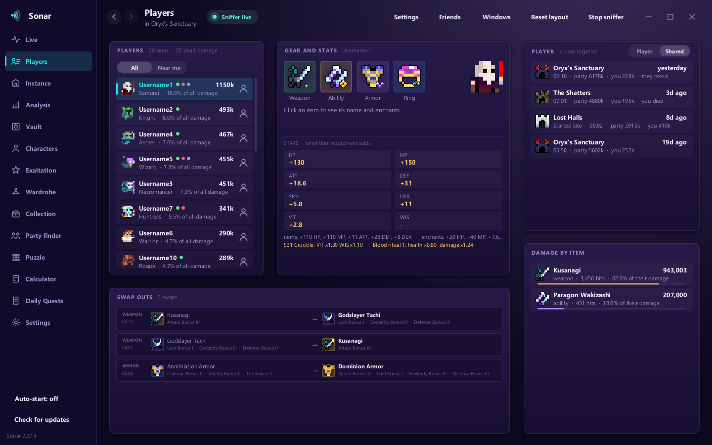

The same window's **Shared** tab is the Instances list filtered to one person: every run the two of you were in together, newest first, with how it ended **for each of you** — *they nexus*, *you died*. Click one and it opens with them already picked out.

## Review a run after it ends

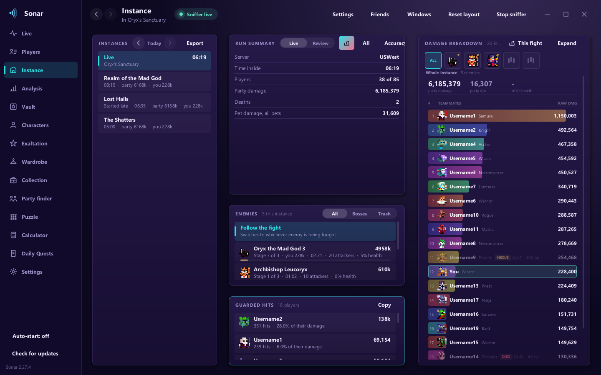

Finished instances are kept. Step back through them, see every enemy that was hit, how long each fight took, how many attackers it had, and how much of its health your party accounted for. Runs are saved to disk day by day, so they survive restarts and updates — and the list knows when Sonar **joined a run late** and says so rather than pretending the numbers are complete.

## Work out who carried it

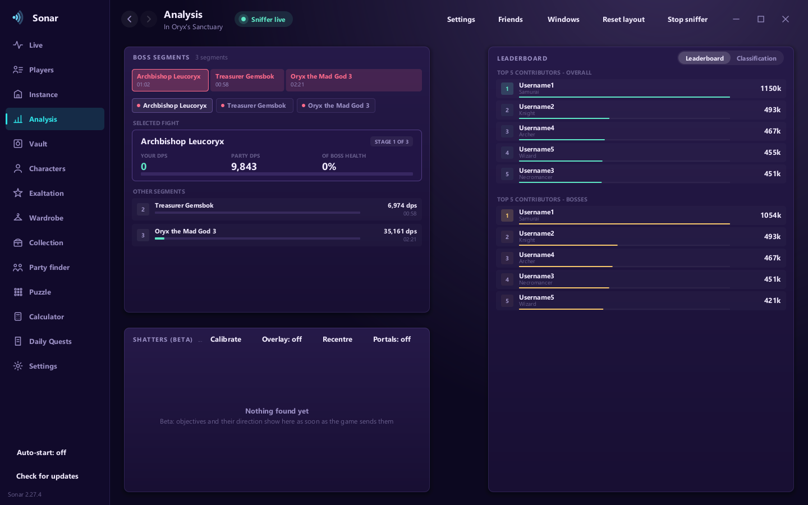

Boss segments laid out in proportion to how long each fight took, top contributors overall and on bosses, and a classification pass that estimates each player's ceiling from their gear and stats — so "pumper" and "leecher" mean *against what they could have done*, not just against each other.

## Post the result without anyone installing anything

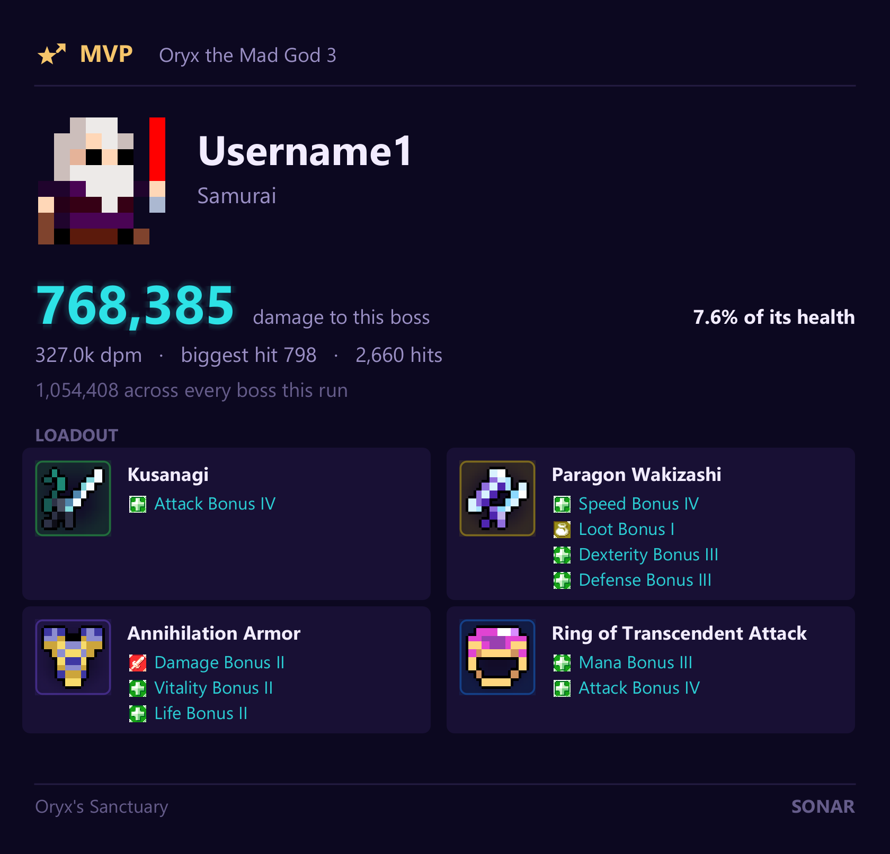

One click copies a finished run straight to your clipboard as an image, ready to paste into Discord — the full roster, or a card for whoever led the final boss, with their loadout. Built for the way these runs actually get organised, where somebody always asks where they stood.

Drawn at **three times the resolution**, because a picture posted in a Discord gets read by zooming in on it — and the game's own art is drawn at a whole multiple of its own pixels, so an item is still an item and an enchant gem is still a gem when you do.

## The Shatters, solved

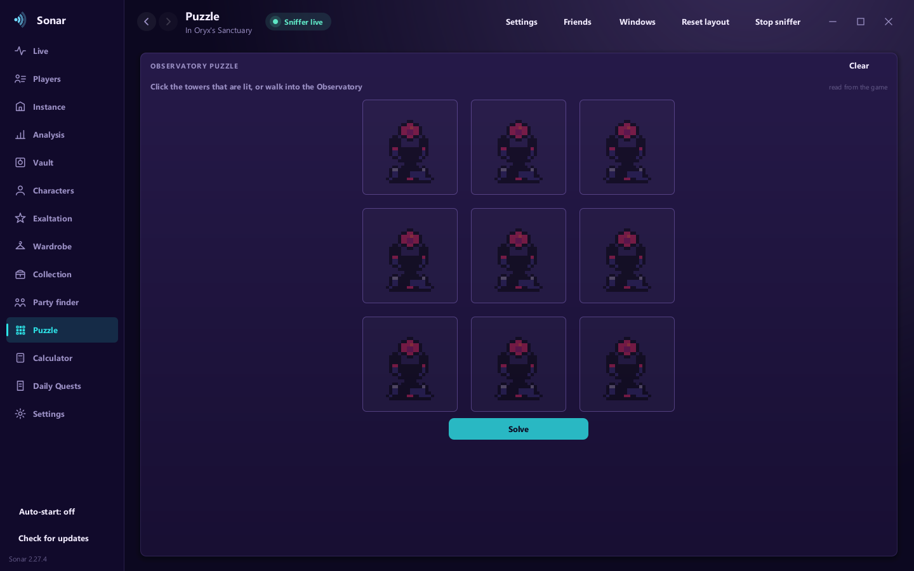

The Observatory puzzle is Lights Out: shoot a tower and it flips, along with the four around it. Sonar already receives every tower's state and position, so unlike the solvers on the web **there is nothing to type in** — walk in and the answer is drawn for you, using the game's own tower sprites so the grid reads the same as the room.

There is also an optional minimap overlay that marks the Stone Idol, the Derelict Monument and the Source as they are spotted.

## Your account, read from the game

<table>
<tr>
<td width="50%">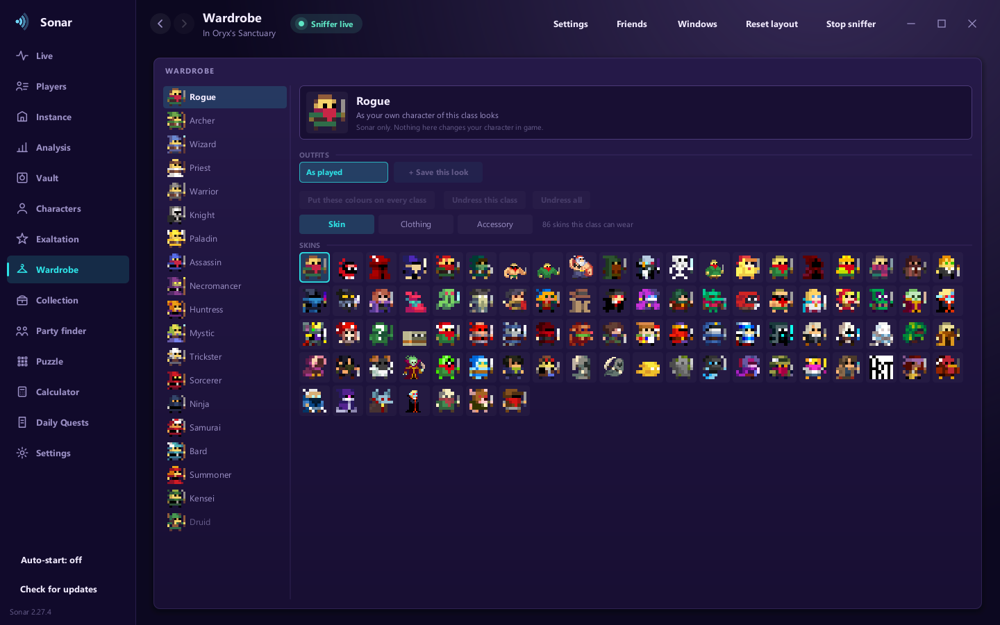</td>
<td width="50%">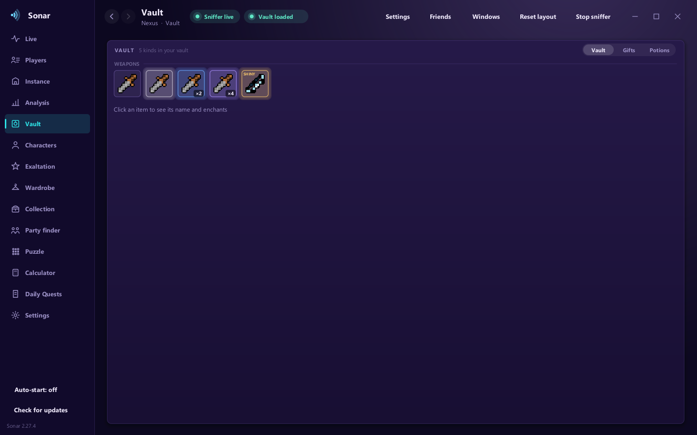</td>
</tr>
<tr>
<td><b>Wardrobe</b> — decide how Sonar draws each class. Every skin that class can wear, all 143 dyes and all 256 cloths for each part, drawn the way the game lays them on. Outfits are saved and reapplied in one click.</td>
<td><b>Vault</b> — your vault, gift chest and potions, with enchants and shinies, read as the game sends them.</td>
</tr>
<tr>
<td>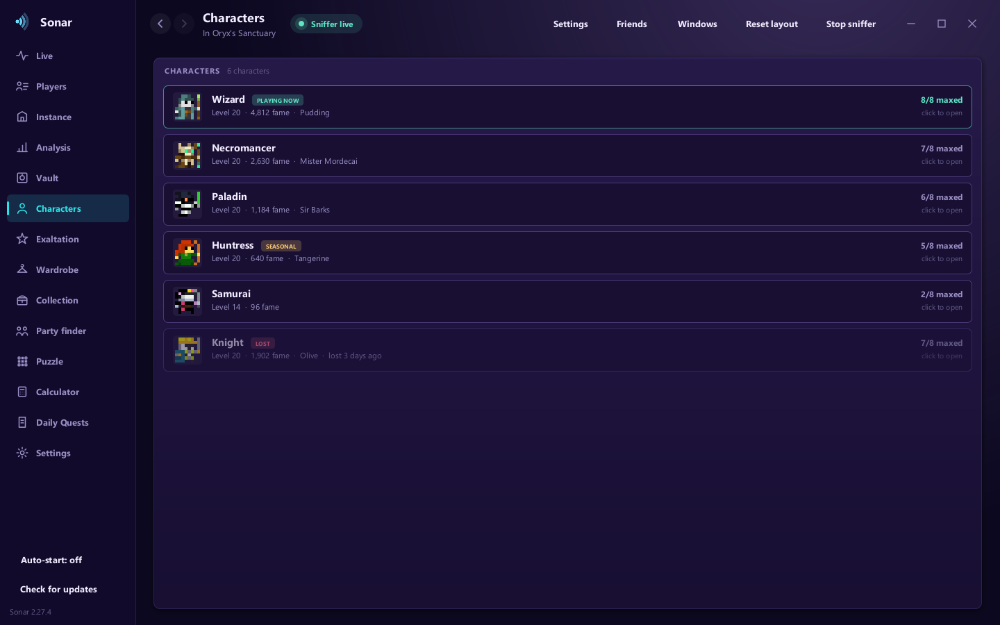</td>
<td>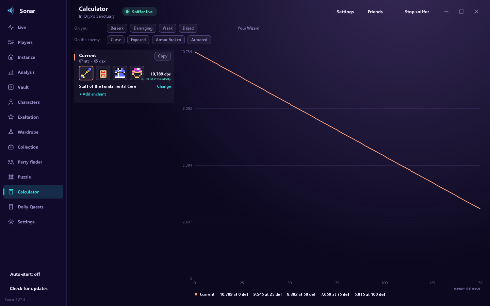</td>
</tr>
<tr>
<td><b>Characters and Exaltation</b> — every character with its stats, fame and maxing, and exalt progress per class. Characters build up as you play them and are remembered on disk.</td>
<td><b>Calculator</b> — compare builds and gear sets against your own character's numbers.</td>
</tr>
</table>

Plus a **Collection**, a **Party finder** listing, and **Daily Quests** as cards rather than a grey panel.

## The rest of it

- **Pings you choose** for white bags and every other bag colour, enchanted drops, dungeon calls in party chat, trades and the realm closing — each with its own sound and its own volume
- **Windows you arrange.** Every page is made of windows you can move, resize and close; the layout is remembered
- **Eight accents and several grounds**, applied to the whole interface at once
- **Self-updating** — Sonar checks GitHub at startup and installs a new version on request
- **Brings its own Java.** Nothing else to install

---

## Install

Download **`Sonar-<version>-setup.msi`** from the [latest release](https://github.com/JustAutomate-AI/sonar-rotmg/releases/latest) and run it. It installs for your user only — **Windows does not ask for administrator rights at any point** — and appears in Add or Remove Programs like any other application.

**Npcap is the prerequisite**, as above. Sonar cannot bring it with it, because its licence forbids redistribution, so install it from [npcap.com](https://npcap.com/) — Sonar also tells you if it is missing and points you there. Npcap's own installer *does* ask for administrator rights, because it installs a driver; it is signed by the Nmap project, the people behind Nmap and Wireshark's Windows capture. Everything except the sniffer works without it, but the sniffer is the point.

A portable `Sonar-<version>-windows.zip` is also published if you would rather not install anything: unpack it anywhere and run `Sonar.exe`.

## What it does with your data

Sonar **reads**. That is a design limit, not a promise:

- **Nothing is ever sent to the game.** No packet injection, no automation, no input simulation. The game's upstream channel is RC4 encrypted and stateful, so anything injected would desync the cipher and disconnect you — listening is the only thing that works, and it is all Sonar does.
- **Nothing leaves your computer** except one request to GitHub's releases page to check for a newer version. No telemetry, no analytics, no uploads, no account. That check is in [`Updater.java`](src/main/java/sonar/ui/Updater.java) and it is the only outbound call in the program.
- **No login, no account access, no password** is involved at any point.

Third-party tools are a grey area under the game's terms of service, and a passive reader is at the mildest end of that. It remains your call and your risk.

## Verifying what you downloaded

Sonar is **not code-signed** — a certificate needs a registered company with three or more years of filings, or several hundred dollars a year, and this is a small project. So Windows may warn you with *"Windows protected your PC"*: **More info**, then **Run anyway**.

You should not take that on faith from a README, so here is how to check instead of trusting. Every release is built by [a public workflow](.github/workflows/release.yml) you can read, and each file carries a signed provenance attestation tying it to the exact commit it was built from:

```
gh attestation verify Sonar-<version>-setup.msi --repo JustAutomate-AI/sonar-rotmg
```

That passes only if the file you have is the file that workflow produced from this source. Each release also ships `SHA256SUMS-<version>.txt`, and the build log is public under the Actions tab.

## Building it yourself

1. Clone this repository.
2. Run `Setup.bat` — it checks the prerequisites (a 64-bit JDK 17, Npcap), offers to install what is missing, and builds Sonar into `run\Sonar.jar`.
3. `tools\make-package.ps1` turns that into the release zip and the installer.

[INSTALL.md](INSTALL.md) has the details and the fixes for known problems.

> The screenshots on this page are Sonar's demo mode. The damage figures are the shape of a real Oryx's Sanctuary run; the names are placeholders, because no real player should end up in a screenshot without being asked.

## Licence

MIT — see [LICENSE.md](LICENSE.md), which ships with every copy.

Sonar includes third-party code under their own terms: the packet-capture layer ([ardikars pcap](https://github.com/ardikars/pcap) on [Npcap](https://npcap.com/)) and asset extraction derived from [UnityPy](https://github.com/K0lb3/UnityPy). Their notices are kept in the source and in the built jar.

## Changes

See [CHANGELOG.md](CHANGELOG.md) for what each version added.
